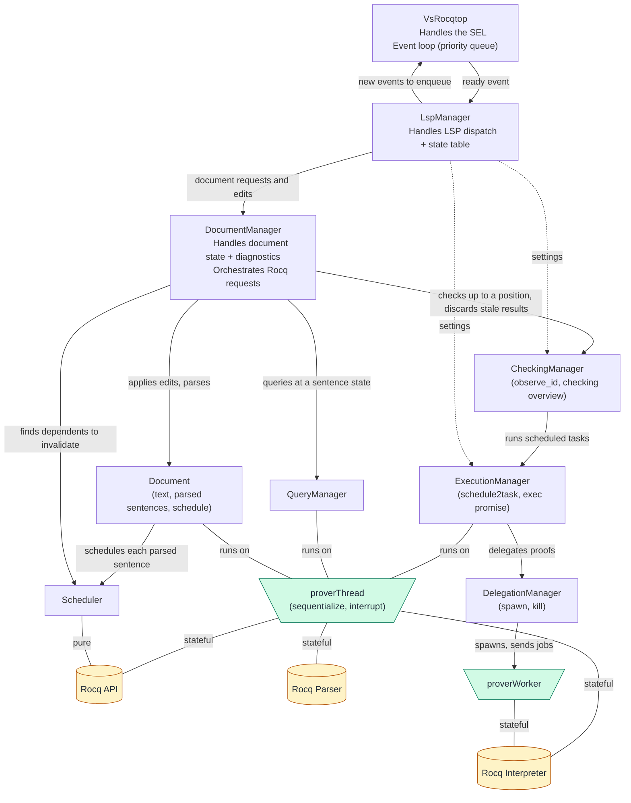

# VsRocq Architecture

This page is intended for software developers who wish to understand VsRocq's architecture.
The two main building blocks are the language server and the VsCode extension (client).

## Language server

The language server is developed in Ocaml and makes it possible to link a client directly to the Rocq API and to exploit the [LSP specification](https://microsoft.github.io/language-server-protocol/specifications/lsp/3.17/specification/).

### Overview and Component Map

VsRocq's language server is a single OCaml process (`vsrocqtop`) that communicates with a client via JSON-RPC over stdin/stdout (standard LSP transport).
Internally, it is structured as a set of cooperating managers orchestrated by an event loop.
Events are queued with different priorities, and popped accordingly, which are then handled by the corresponding manager.
In particular, the components are:

* **VsRocqtop:** Handles the main event loop, enqueueing and dequeuing events, and routes them along.
* **LSPManager:** Handles the LSP side of the server. It reads and writes JSON-RPC messages, handles the server lifecycle (`initialize`, `shutdown`) and configuration, and keeps one `DocumentManager` per open document. Routes the requests about a document to its `DocumentManager` and sends the results back, as responses or as notifications (diagnostics, highlights, proof view).
* **DocumentManager:** Handles the general state of a document, from parsing and execution, as well as feedback and diagnostics from these processes. There is one per open document. It orchestrates the responses to the requests about that document, both standard LSP ones (edits, hover, symbols) and Rocq specific ones (stepping, `Search`, `About`), connecting the responsible managers.
* **Document:** Handles the raw and parsed document representations. Orchestrates the parsing and scheduling processes.
* **Scheduler:** Handles the incremental planning of execution. It groups sentences into tasks, decides which proofs can be delegated, and tracks dependencies between sentences for invalidation.
* **QueryManager:** Handles specific Rocq queries (`Search`, `About`, hover, completion, etc.).
* **CheckingManager:** Handles document checking. Tracks the sentence the user wants checked up to (`observe_id`), runs the scheduled tasks up to it through the `ExecutionManager`, and keeps the overview of checked ranges.
* **ExecutionManager:** Handles execution of the Rocq interpreter. Holds the Rocq state of each executed sentence.
* **DelegationManager:** Handles worker processes. Spawns them and sends them jobs, such as delegated proofs.

The *document* data structure holds:
- the text
- the parsed document (AST of each sentence, mapping between text positions and sentences)
- the checked document (each sentence comes with a checking result)
- the feedback (each message by the prover is attached to the corresponding sentence)
### Events
